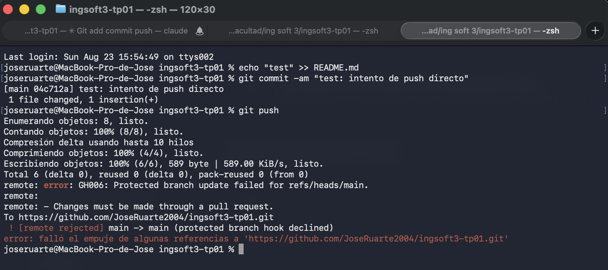
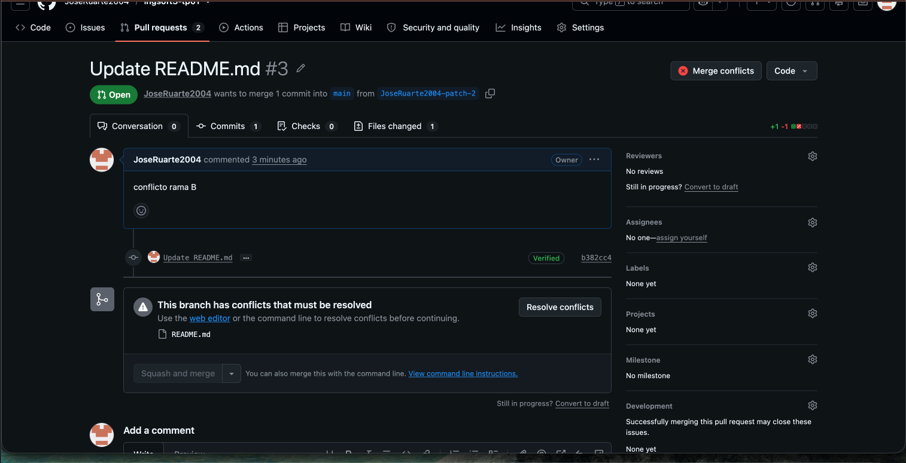
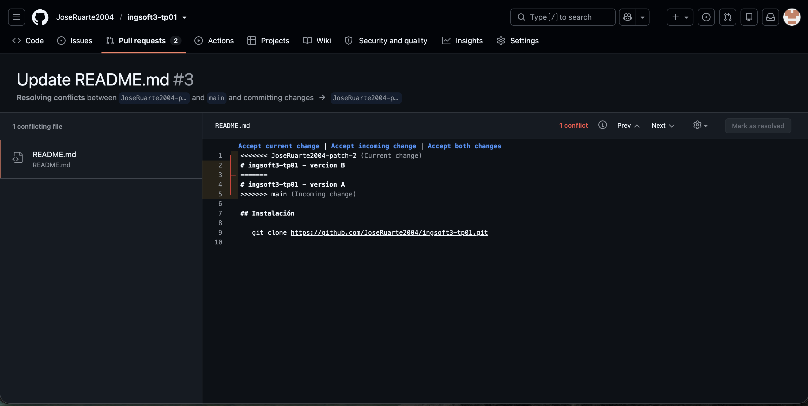
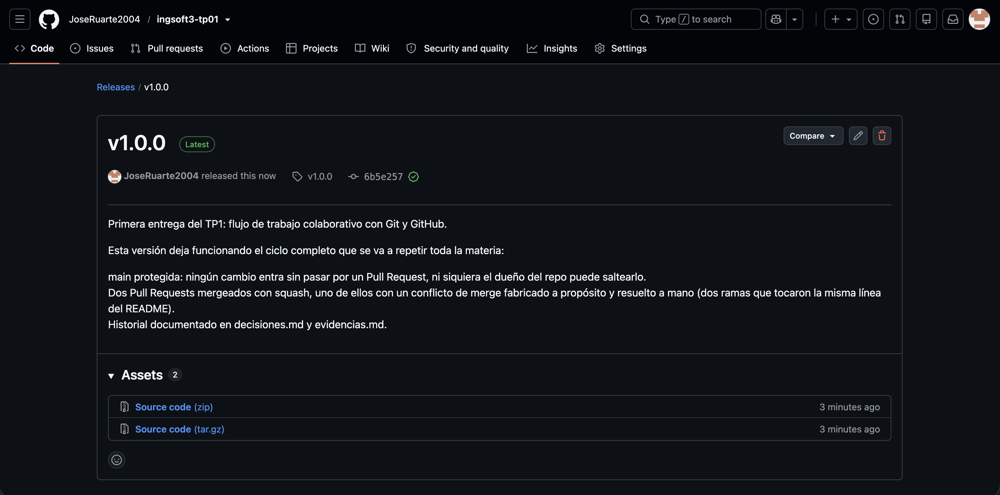

# Evidencias — TP1

## 1. Push directo a main rechazado

GitHub rechaza el intento de push directo a `main` porque la rama está protegida y la regla alcanza también al dueño del repositorio (sin bypass).

## 2. Aviso de conflicto en el PR de la rama B

Al intentar mergear el PR de la rama B después de haber mergeado la rama A, GitHub avisa que no se puede mergear automáticamente porque ambas ramas modificaron la misma línea del README.

## 3. Marcadores de conflicto

El editor de conflictos de GitHub muestra los marcadores `<<<<<<<`, `=======` y `>>>>>>>` delimitando el cambio de la rama actual (B) contra el de `main` (A).

## 4. Release v1.0.0 publicada

La release `v1.0.0`, generada a partir del tag del mismo nombre, publicada con las notas de qué incluye esta versión.

---

# Evidencias — TP2

## 1. `docker compose up -d --build` desde cero, sistema funcionando end-to-end

```
$ docker compose down -v
 Volume ingsoft3-tp01_db-data Removed

$ docker compose up -d --build
 Image ingsoft3-tp01-backend Built
 Image ingsoft3-tp01-frontend Built
 Container ingsoft3-tp01-db-1 Started
 Container ingsoft3-tp01-db-1 Waiting
 Container ingsoft3-tp01-db-1 Healthy
 Container ingsoft3-tp01-backend-1 Started
 Container ingsoft3-tp01-frontend-1 Started

$ docker compose ps
NAME                       IMAGE                    SERVICE    STATUS
ingsoft3-tp01-backend-1    ingsoft3-tp01-backend    backend    Up (healthy dependency)
ingsoft3-tp01-db-1         postgres:14-alpine       db         Up (healthy)
ingsoft3-tp01-frontend-1   ingsoft3-tp01-frontend   frontend   Up
```

Prueba funcional real, de punta a punta (frontend → nginx → backend → Postgres), registrando un usuario, logueándose y creando un producto vía `curl` contra el proxy del frontend (puerto 3000, no el backend directo):

```
$ curl -s http://localhost:3000/csrf/
{"csrfToken":"..."}

$ curl -s -X POST http://localhost:3000/users/register -H "X-CSRF-Token: ..." \
  -d '{"username":"tpdemo","password":"Test1234!","email":"tpdemo@example.com"}'
User creation successful.

$ curl -s -X POST http://localhost:3000/users/login -H "X-CSRF-Token: ..." \
  -d '{"username":"tpdemo","password":"Test1234!"}'
User Authorized

$ curl -s -X POST http://localhost:3000/products -H "X-CSRF-Token: ..." \
  -d '{"name":"Leche","quantity":2,"storageLocation":"Heladera","freezable":false}'
{"id":1,"name":"Leche","quantity":2,"expiryDate":null,"storageLocation":"Heladera","freezable":false,"userId":1,...}

$ curl -s http://localhost:3000/products
[{"id":1,"name":"Leche","quantity":2,"expiryDate":null,"storageLocation":"Heladera","freezable":false,"createdAt":"...","updatedAt":"...","userId":1}]
```

El dato pasó por los 3 servicios: el frontend (nginx) recibió la request, la proxyó al backend (`/products` sin prefijo `/api`, según cómo está montada la ruta en `api/app.js`), el backend la escribió en Postgres vía Sequelize, y `GET /products` la devolvió leyéndola de la base.

## 2. Prueba de persistencia: `down` conserva, `down -v` borra

**Caso A — `down` sin `-v`: el dato sobrevive**

```
$ docker compose down
 Container ingsoft3-tp01-frontend-1 Removed
 Container ingsoft3-tp01-backend-1 Removed
 Container ingsoft3-tp01-db-1 Removed
 Network ingsoft3-tp01_default Removed
 (el volumen db-data NO se tocó)

$ docker compose up -d
 Container ingsoft3-tp01-db-1 Healthy
 Container ingsoft3-tp01-backend-1 Started
 Container ingsoft3-tp01-frontend-1 Started

$ curl -s -b cookies.txt http://localhost:3000/products
[{"id":1,"name":"Leche","quantity":2, ... "userId":1}]
```

El producto sigue ahí después de recrear los tres contenedores: el volumen nombrado sobrevivió.

**Caso B — `down -v`: el dato se borra de verdad**

```
$ docker compose down -v
 Volume ingsoft3-tp01_db-data Removed

$ docker compose up -d
 Volume ingsoft3-tp01_db-data Created
 Container ingsoft3-tp01-db-1 Healthy
 Container ingsoft3-tp01-backend-1 Started

$ curl -s -b cookies.txt http://localhost:3000/products
Not authenticated, access is blocked.
```

Con `-v` se borró también el volumen: la base arrancó vacía, el backend recreó el schema (`bin/migrate.js` corre al iniciar el contenedor), y hasta el usuario `tpdemo` dejó de existir — la cookie de sesión ya no resuelve a nadie real. Es una prueba más contundente que "la lista de productos está vacía": muestra que la base se recreó desde cero.

## 3. Comparación de tamaño: imagen final vs. imagen de build

```
$ docker images --format "table {{.Repository}}:{{.Tag}}\t{{.Size}}"
REPOSITORY:TAG                        SIZE
ingsoft3-tp01-backend:latest          301MB   ← runtime, sin compilador
evidencia-api-build-stage:latest      723MB   ← con python3/make/g++ para compilar bcrypt
ingsoft3-tp01-frontend:latest         77.1MB  ← nginx + estáticos
evidencia-client-build-stage:latest   846MB   ← con todo el toolchain de webpack/babel
```

**Backend**: 723MB → 301MB (-58%). **Frontend**: 846MB → 77.1MB (-91%, es la diferencia más grande porque el runtime ni siquiera es Node: es nginx sirviendo archivos estáticos).

## 4. Imágenes publicadas en el registry, públicas de verdad

Publicadas en GitHub Container Registry:
- `ghcr.io/joseruarte2004/ingsoft3-tp01-backend:v0.1.0`
- `ghcr.io/joseruarte2004/ingsoft3-tp01-frontend:v0.1.0`

Visibilidad pública confirmada bajando ambas **sin sesión** (deslogueado de `docker login`):

```
$ docker logout ghcr.io
Removing login credentials for ghcr.io

$ docker pull ghcr.io/joseruarte2004/ingsoft3-tp01-backend:v0.1.0
v0.1.0: Pulling from joseruarte2004/ingsoft3-tp01-backend
Status: Downloaded newer image for ghcr.io/joseruarte2004/ingsoft3-tp01-backend:v0.1.0

$ docker pull ghcr.io/joseruarte2004/ingsoft3-tp01-frontend:v0.1.0
v0.1.0: Pulling from joseruarte2004/ingsoft3-tp01-frontend
Status: Downloaded newer image for ghcr.io/joseruarte2004/ingsoft3-tp01-frontend:v0.1.0
```

Y probado con `docker-compose.registry.yml` (la variante que descarga en vez de construir), levantando el sistema completo desde las imágenes publicadas:

```
$ docker compose -f docker-compose.registry.yml up -d
 Container ingsoft3-tp01-db-1 Healthy
 Container ingsoft3-tp01-backend-1 Started
 Container ingsoft3-tp01-frontend-1 Started

$ curl -s -o /dev/null -w "frontend HTTP %{http_code}\n" http://localhost:3000/
frontend HTTP 200
$ curl -s -o /dev/null -w "proxy /csrf/ HTTP %{http_code}\n" http://localhost:3000/csrf/
proxy /csrf/ HTTP 200
```
